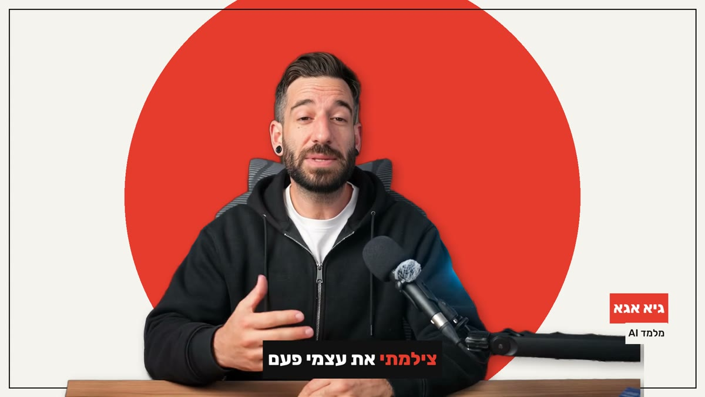

# Twin Studio: a Claude Code skill

**Your digital twin, for any video. Write what to say and get a video of you saying it: your HeyGen avatar, in your
cloned voice, with captions that light up word by word, your name tag and your brand colours.**


*Example: Guy Aga's twin in the `studio` frame. Your clips star your own twin.*

> התאום הדיגיטלי שלכם, לכל סרטון. כותבים מה להגיד ומקבלים סרטון שלכם מדברים: האווטאר שלכם מ-HeyGen בקול המשובט שלכם,
> עם כתוביות שנדלקות מילה אחרי מילה, שם ותפקיד, ועיצוב בצבעי המותג. מתאים להסבר על העבודה שלכם, פתיח לקורס, סרטון
> ברוכים הבאים או הודעה ללקוחות, ב-16:9, 9:16, ריבוע או 4:5. רוצים לשלב את עצמכם בעריכה? מקבלים גם את התאום על רקע שקוף.

1. **Script**: yours, or Claude writes it from a topic, in your language
2. **Voice**: your cloned voice on ElevenLabs v4 (or HeyGen's voice)
3. **Twin**: HeyGen lip-syncs your avatar to it, on a transparent background
4. **Frame**: `studio`, `spotlight`, `side` (best for explainers), `image` (your own background) or `plain`, in
   16:9, 9:16, 1:1 or 4:5, with captions, a name tag and a title
5. **Re-styling is free**: another frame or aspect from the same render costs nothing

## Install

Paste into Claude Code:

```
Install the Twin Studio skill: clone https://github.com/guyaga/10d10s-bonus-twin-studio into ~/.claude/skills/twin-studio (git pull there if it already exists). Install any free tool that is missing on this computer (git, Python 3.12, ffmpeg) yourself. Then run python -I -X utf8 ~/.claude/skills/twin-studio/scripts/setup.py and follow the skill's "Install and first run" section step by step: talk to me in Hebrew, in plain words, and wait for me after each step. Never ask me to paste an API key into this chat: run creator.py keys so I can paste them into the key file. Don't spend HeyGen credits without asking me first. When setup says READY, run the free selftest and show me the result.
```

Then just ask: *"Make me a one-minute clip where my twin explains what I do, side frame with a title"*.

## What you need

| | Needed | Notes |
|---|---|---|
| A HeyGen account and **your own avatar** | Required | Avatars → Create avatar. A twin from a short video looks best (it asks for a consent recording); a photo avatar also works. |
| `HEYGEN_API_KEY` + money in the **API wallet** | Required | HeyGen → Settings → API. The API wallet is separate from the HeyGen plan: Add funds, $10–15 to start. |
| `ELEVEN_API_KEY` + a voice clone | Recommended | ElevenLabs (Day 5 of the course). Instant voice clone needs Starter or higher. Without it, the HeyGen voice is used. |
| Python 3.10+, git, ffmpeg | Installed for you | Claude installs them (winget on Windows, Homebrew on Mac). `setup.py` also downloads the Whisper model for captions (about 1.5 GB, once). |

Keys go in `~/.twin-studio/.env` (`creator.py keys` opens it in a text editor) or in environment variables.
`creator.py check` tests every key for free and shows your HeyGen balance.

## What it costs

About **$0.12 per second** of video from the HeyGen API wallet: about $4 for 30 seconds. `make.py --dry-run` shows the
price before every render, and the skill asks before it spends. ElevenLabs uses characters from your plan. Everything
else runs on your computer for free.

## Privacy

Use only your own face and your own voice. Never clone someone else.

## The scripts

| Script | What it does |
|---|---|
| `scripts/setup.py` | one-time install and check: packages, ffmpeg, the Whisper model, the profile, the keys; ends with READY or what to fix |
| `scripts/selftest.py` | a free end-to-end test with a stand-in figure: no HeyGen, no keys |
| `scripts/creator.py` | the profile and keys: `keys`, `check`, `looks`, `voices`, `set`, `show` |
| `scripts/make.py` | one command: script → voice → twin → frame (`--dry-run` shows the price and anything missing) |
| `scripts/frame.py` | the design: background, placement, captions, name tag, title; `--still` for a preview frame |

The profile (`~/.twin-studio/profile.json`) is shared with the `twin-reel-studio` skill: set up once, use both.
